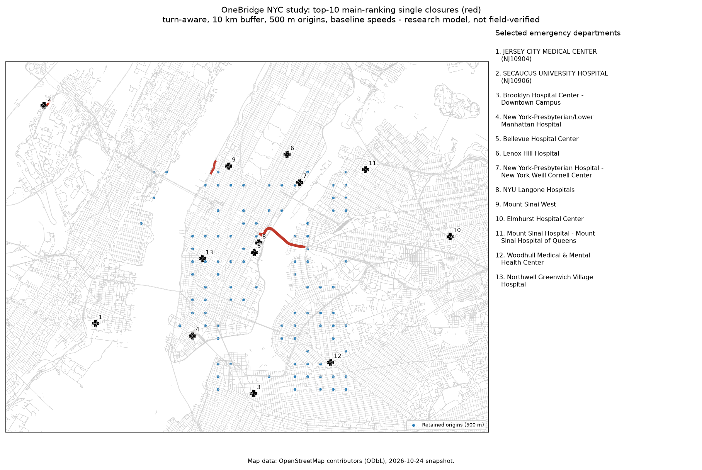

# OneBridge

Which single road closure most increases travel time to the nearest emergency
department?

OneBridge answers that for a study area by routing from a grid of origins to
the nearest hospital emergency department (ED) on an OpenStreetMap road graph,
then closing one road segment, structure or river crossing at a time and
measuring the added minutes. The included study covers Lower and Midtown
Manhattan, northern Brooklyn, western Queens and the Hudson waterfront in New
Jersey, with 18 EDs.

## Results in brief

On the primary configuration (500 m origin grid, 10 km routing buffer,
baseline speeds, turn-aware routing), all 96 origins reach an ED, with a
median trip of 2.52 minutes. The closures that add the most time in total
across those origins are:

| Rank | Closure | Added minutes (total over 96 origins) |
| ---: | --- | ---: |
| 1-7 | 12th Avenue, Midtown West (seven consecutive segments, one corridor) | 8.84-8.88 |
| 8-9 | Meadowlands Parkway, Secaucus (two segments) | 6.89 |
| 10-12 | Queens-Midtown Tunnel and its two Long Island Expressway approaches | 6.59 |
| 14-15 | Ashland Place, Brooklyn (two segments) | 4.15 |



Single closures add little in this dense, ED-rich area: under six seconds per
origin on average for the leading closure. On the 250 m grid the
Queens-Midtown Tunnel group leads (20.17 minutes over 350 reachable origins).
See [docs/RESULTS.md](docs/RESULTS.md) for the full results, sensitivities and
limitations. The complete report (ranking, route outcomes, sensitivity
comparison, evidence and map) is attached to the v0.2.1 release as
[`onebridge-nyc-report-0.2.1.tar.gz`](https://github.com/gfonseca-labs/onebridge/releases/tag/v0.2.1).

The ranking sums added time for origins that remain reachable. Complete loss
of ED access is counted separately and never increases a closure's score:
36 main-ranking scenarios disconnect one origin each. Endpoint-road closures
are listed separately. This is a delay ranking, not an overall emergency-risk ranking.

This is a research model of road travel time to a public road approach at
each ED. It is not ambulance response time, live traffic, door-to-treatment
time or clinical advice.

## Try the synthetic demo

```sh
git clone https://github.com/gfonseca-labs/onebridge.git
cd onebridge
git checkout v0.2.1
python3 -m venv .venv
. .venv/bin/activate
python -m pip install -e '.[report]'
onebridge demo --out out/demo
```

`demo` runs the whole study (every configuration, the sensitivity comparison
and the evidence report) on a tiny invented street grid with one hospital,
with no source-data downloads. Installation still needs package dependencies.
Open `out/demo/report/evidence/ranking.csv` and `map.png`
to see what a report looks like.

## Install

Python 3.11 or newer. CI tests Linux and macOS with Python 3.11 and 3.13.
The complete NYC rebuild was checked on macOS with Python 3.13; Windows
support has not been established. Run the following from the checkout:

```sh
python3 -m venv .venv
. .venv/bin/activate
python -m pip install -e '.[prepare,report,test]'
python -m pytest
```

The `prepare` extra (OSMnx, pyosmium, pyogrio) is only needed to build a
bundle from source data; `run` and `report` need only the core and `report`
dependencies.

## Usage

The pipeline has four commands:

```sh
onebridge extract --config config/nyc.toml --downloads data/downloads --out data/nyc-extract
onebridge prepare --config config/nyc.toml --extract data/nyc-extract \
    --sources data/nyc-sources --downloads data/downloads --out data/nyc-bundle
onebridge run --bundle data/nyc-bundle --out out/runs
onebridge report --bundle data/nyc-bundle --run out/runs --out out/report
```

- `extract` reads the pinned OpenStreetMap extracts and builds the road graph
  for each routing buffer.
- `prepare` applies the review tables in `data/nyc-sources` and writes a
  bundle: usable edges with travel times, origins, hospital arrivals and
  closure candidates.
- `run` computes baseline routes and every closure scenario for each
  configuration in the study matrix.
- `report` writes ranking tables, the sensitivity comparison and the evidence
  directory (`ranking.csv`, `route_outcomes.jsonl`, `endpoint_convention.csv`,
  `evidence.json`, `map.png`).

Use a new output directory for each command. Failed commands can leave
partial directories; inspect them and rerun with a fresh output path.
Expected success returns exit code 0; invalid arguments return 2. Other
errors return nonzero and may include a Python traceback. See
[architecture and failure behavior](docs/ARCHITECTURE.md).
`python scripts/download.py` fetches and checks the Census and NYC files;
[docs/DATA.md](docs/DATA.md) lists every download and
[docs/REPRODUCE.md](docs/REPRODUCE.md) walks through a full rebuild.

## Repository layout

```
config/nyc.toml        study area, speeds, grids, pinned downloads
data/nyc-sources/      reviewed source tables (roads, origins, hospitals, crossings)
docs/                  METHODS, DATA, RESULTS, REPRODUCE
scripts/               downloads and release packaging
src/onebridge/         routing, turn restrictions, closures, ranking, evidence
src/onebridge/prepare/ extraction and bundle preparation
src/onebridge/study/   run matrix, scenarios, comparison and report
tests/
```

## Documentation

- [Methods and assumptions](docs/METHODS.md)
- [Results and sensitivities](docs/RESULTS.md)
- [Data sources and review tables](docs/DATA.md)
- [Full reproduction](docs/REPRODUCE.md)
- [Architecture and failure behavior](docs/ARCHITECTURE.md)
- [Changelog](CHANGELOG.md)

## Licence

Code: MIT ([LICENSE](LICENSE)). Data derived from OpenStreetMap, including
`data/nyc-sources` and every bundle and report built from it, is
© OpenStreetMap contributors and available under the Open Database License;
see [NOTICE.md](NOTICE.md) for all sources and their terms.
